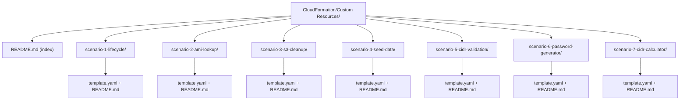
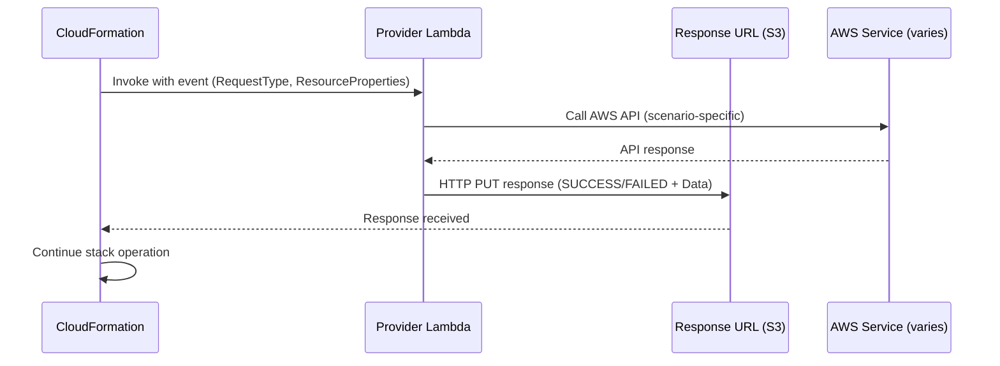

# Design Document: Custom Resources Learning

## Overview

This design covers a hands-on learning project that teaches CloudFormation custom resources through seven enterprise scenarios. Each scenario is a self-contained CloudFormation template with inline Python Lambda code (ZipFile), deployed and managed via AWS CLI. The project lives under `CloudFormation/Custom Resources/` with numbered scenario subdirectories.

The scenarios progress from foundational lifecycle mechanics through increasingly complex patterns: data fetching, resource cleanup, post-provisioning, validation gating, computed values, and cross-service computation. Each scenario template is fully self-contained — no external packaging, S3 uploads, or build steps required.

### Design Decisions

1. **Inline Lambda (ZipFile) only** — All Provider Lambda code is embedded in templates using `AWS::Lambda::Function` with `Code.ZipFile`. This keeps scenarios self-contained and eliminates packaging complexity. The tradeoff is a 4,096-byte code limit per function, which is acceptable for tutorial-scoped logic.

2. **Python 3.12 runtime** — All Lambda functions use `python3.12`. The `cfn-response` module is automatically available for ZipFile-deployed functions, simplifying response handling.

3. **One template per scenario** — Each scenario is a single YAML template. No nested stacks or cross-stack references. This makes each scenario independently deployable and deletable.

4. **Least-privilege IAM inline** — Each template defines its own IAM role with scoped permissions. No shared roles across scenarios.

5. **CLI-driven workflow** — Deployment follows the `commands.md` pattern from `CloudFormation/Tutorials/100/`, using `aws cloudformation create-stack`, `update-stack`, and `delete-stack`.

## Architecture

The project follows a flat scenario-based architecture. Each scenario is independent and demonstrates one enterprise pattern.



### CloudFormation Custom Resource Flow

Each scenario follows the same lifecycle flow:




## Components and Interfaces

### Scenario 1: Lifecycle Mechanics (`scenario-1-lifecycle/`)

**Pattern:** Foundational — demonstrates Create, Update, Delete handling.

**Resources:**
- `LifecycleProvider` — `AWS::Lambda::Function` (ZipFile, python3.12). Logs the event, branches on `RequestType`, sends response via `cfn-response`.
- `LifecycleProviderRole` — `AWS::IAM::Role` with basic Lambda execution policy (CloudWatch Logs only).
- `LifecycleResource` — `Custom::Lifecycle` referencing the Lambda as ServiceToken.

**Behavior:**
- Create: Logs event payload, returns SUCCESS with a generated PhysicalResourceId.
- Update: Compares `ResourceProperties` vs `OldResourceProperties`, logs diff, returns SUCCESS with same PhysicalResourceId.
- Delete: Logs cleanup, returns SUCCESS.
- Error path: Demonstrates FAILED response with Reason field.

### Scenario 2: AMI Lookup (`scenario-2-ami-lookup/`)

**Pattern:** Data Fetching — queries EC2 API at deploy time.

**Resources:**
- `AmiLookupProvider` — `AWS::Lambda::Function`. Calls `ec2:DescribeImages` with filters from ResourceProperties (Owner, NamePattern, Architecture).
- `AmiLookupProviderRole` — `AWS::IAM::Role` with `ec2:DescribeImages` permission.
- `AmiLookup` — `Custom::AmiLookup` passing filter parameters.
- `DemoInstance` — `AWS::EC2::Instance` using `!GetAtt AmiLookup.AmiId`.

**Interface (Response Data):**
- `AmiId` — The latest AMI ID matching the filters.

### Scenario 3: S3 Bucket Cleanup (`scenario-3-s3-cleanup/`)

**Pattern:** Resource Cleanup — empties bucket on stack deletion.

**Resources:**
- `DemoBucket` — `AWS::S3::Bucket` with versioning enabled.
- `BucketEmptierProvider` — `AWS::Lambda::Function`. On Delete: lists all object versions, batch-deletes them. On Create/Update: no-op SUCCESS.
- `BucketEmptierRole` — `AWS::IAM::Role` with `s3:ListBucket`, `s3:ListBucketVersions`, `s3:DeleteObject`, `s3:DeleteObjectVersion` scoped to `DemoBucket`.
- `BucketEmptier` — `Custom::BucketEmptier` with `DependsOn: DemoBucket`. The `BucketName` is passed as a ResourceProperty.

**Deletion order:** CloudFormation deletes `BucketEmptier` first (triggering the emptying Lambda), then deletes `DemoBucket`.

### Scenario 4: DynamoDB Seed Data (`scenario-4-seed-data/`)

**Pattern:** Post-Provisioning — populates table after creation.

**Resources:**
- `SeedTable` — `AWS::DynamoDB::Table` with a simple key schema.
- `SeedDataProvider` — `AWS::Lambda::Function`. On Create: `dynamodb:BatchWriteItem` with seed data from ResourceProperties. Retries unprocessed items (exponential backoff, 3 attempts). On Update: writes new seed data (overwrites matching keys). On Delete: no-op SUCCESS.
- `SeedDataRole` — `AWS::IAM::Role` with `dynamodb:BatchWriteItem` scoped to `SeedTable`.
- `SeedData` — `Custom::SeedData` with `DependsOn: SeedTable`.

**Interface (ResourceProperties):**
- `TableName` — Target DynamoDB table name.
- `SeedItems` — JSON array of items to write.

### Scenario 5: CIDR Validation (`scenario-5-cidr-validation/`)

**Pattern:** Validation Gate — blocks VPC creation if CIDR overlaps.

**Resources:**
- `CidrValidatorProvider` — `AWS::Lambda::Function`. On Create: calls `ec2:DescribeVpcs`, checks requested CIDR against all existing VPC CIDRs using `ipaddress` module. Returns FAILED if overlap, SUCCESS with validated CIDR if clean. On Delete: no-op SUCCESS.
- `CidrValidatorRole` — `AWS::IAM::Role` with `ec2:DescribeVpcs`.
- `CidrValidation` — `Custom::CidrValidation` with `RequestedCidr` property.
- `DemoVpc` — `AWS::EC2::VPC` with `DependsOn: CidrValidation`, using `!GetAtt CidrValidation.ValidatedCidr`.

**Interface (Response Data):**
- `ValidatedCidr` — The CIDR block that passed validation.

### Scenario 6: Password Generator (`scenario-6-password-generator/`)

**Pattern:** Computed Values — generates random password, stores in Secrets Manager.

**Resources:**
- `GeneratedSecret` — `AWS::SecretsManager::Secret` (initially empty or placeholder).
- `PasswordGenProvider` — `AWS::Lambda::Function`. On Create: generates random password using `secrets` module, calls `secretsmanager:PutSecretValue`. Returns `SecretArn` with `NoEcho: true`. On Update (length changed): regenerates and updates. On Delete: no-op SUCCESS.
- `PasswordGenRole` — `AWS::IAM::Role` with `secretsmanager:PutSecretValue` scoped to `GeneratedSecret`.
- `PasswordGenerator` — `Custom::PasswordGenerator` with `PasswordLength` and `SecretArn` properties.

**Interface (Response Data):**
- `SecretArn` — ARN of the Secrets Manager secret containing the password.

### Scenario 7: CIDR Calculator (`scenario-7-cidr-calculator/`)

**Pattern:** Cross-Service Computation — computes next available subnet CIDR.

**Resources:**
- `CidrCalcProvider` — `AWS::Lambda::Function`. On Create: queries `ec2:DescribeSubnets` for existing subnets in the VPC, uses `ipaddress` module to find next available CIDR of requested prefix length. Returns FAILED if exhausted. On Delete: no-op SUCCESS.
- `CidrCalcRole` — `AWS::IAM::Role` with `ec2:DescribeSubnets`.
- `CidrCalculation` — `Custom::CidrCalculator` with `VpcId`, `VpcCidr`, and `SubnetPrefixLength` properties.
- `DemoSubnet` — `AWS::EC2::Subnet` using `!GetAtt CidrCalculation.SubnetCidr`.

**Interface (Response Data):**
- `SubnetCidr` — The computed non-overlapping subnet CIDR block.

### Cross-Cutting: Response Helper Pattern

All Provider Lambdas use the `cfn-response` module (auto-available for ZipFile deployments):

```python
import cfnresponse

def handler(event, context):
    try:
        # scenario-specific logic
        cfnresponse.send(event, context, cfnresponse.SUCCESS, response_data)
    except Exception as e:
        cfnresponse.send(event, context, cfnresponse.FAILED, {}, reason=str(e))
```

This pattern satisfies Requirement 8 (always send a response) and Requirement 9 (correct response protocol).

## Data Models

### Custom Resource Event Payload (Input to Provider Lambda)

```json
{
  "RequestType": "Create | Update | Delete",
  "ServiceToken": "arn:aws:lambda:region:account:function:name",
  "ResponseURL": "https://pre-signed-s3-url",
  "StackId": "arn:aws:cloudformation:region:account:stack/name/id",
  "RequestId": "unique-request-id",
  "ResourceType": "Custom::ResourceName",
  "LogicalResourceId": "MyCustomResource",
  "PhysicalResourceId": "provider-defined-id (empty on Create)",
  "ResourceProperties": {
    "ServiceToken": "arn:aws:lambda:...",
    "Key1": "Value1"
  },
  "OldResourceProperties": {
    "ServiceToken": "arn:aws:lambda:...",
    "Key1": "OldValue1"
  }
}
```

`OldResourceProperties` is only present on Update requests.

### Custom Resource Response Payload (Output from Provider Lambda)

```json
{
  "Status": "SUCCESS | FAILED",
  "Reason": "Description of failure (required if FAILED)",
  "PhysicalResourceId": "provider-defined-unique-id",
  "StackId": "copied from event",
  "RequestId": "copied from event",
  "LogicalResourceId": "copied from event",
  "NoEcho": false,
  "Data": {
    "Key1": "Value1"
  }
}
```

**Constraints:**
- `Data` object is limited to 4,096 bytes.
- `Data` keys become accessible via `Fn::GetAtt`.
- `NoEcho: true` prevents values from appearing in stack events/API responses.
- `PhysicalResourceId` is required. Changing it on Update triggers a Delete of the old resource.
- `StackId`, `RequestId`, and `LogicalResourceId` must be copied from the incoming event.

### Scenario-Specific Response Data

| Scenario | Data Keys | Description |
|----------|-----------|-------------|
| 2 - AMI Lookup | `AmiId` | Latest AMI ID matching filters |
| 5 - CIDR Validation | `ValidatedCidr` | CIDR that passed overlap check |
| 6 - Password Generator | `SecretArn` | ARN of the Secrets Manager secret |
| 7 - CIDR Calculator | `SubnetCidr` | Computed non-overlapping subnet CIDR |

### Seed Data Model (Scenario 4)

Seed items are passed as a JSON-encoded array in ResourceProperties:

```json
{
  "SeedItems": [
    {"PK": {"S": "CONFIG#app"}, "SK": {"S": "v1"}, "Value": {"S": "initial"}},
    {"PK": {"S": "CONFIG#feature"}, "SK": {"S": "v1"}, "Value": {"S": "enabled"}}
  ]
}
```

Items use DynamoDB JSON format for direct use with `BatchWriteItem`.

## Correctness Properties

*A property is a characteristic or behavior that should hold true across all valid executions of a system — essentially, a formal statement about what the system should do. Properties serve as the bridge between human-readable specifications and machine-verifiable correctness guarantees.*

### Property 1: AMI selection picks the most recent image

*For any* non-empty list of AMI results with distinct CreationDate values, the AMI lookup provider's selection logic should always return the AMI with the latest CreationDate.

**Validates: Requirements 2.3**

### Property 2: Read-only providers return SUCCESS on Delete without side effects

*For any* Delete request event payload sent to a read-only or computation-only provider (AMI Lookup, CIDR Validation, CIDR Calculator, Seed Data Loader, Password Generator), the provider should return a SUCCESS status and make no mutating API calls.

**Validates: Requirements 2.6, 3.6, 4.4, 5.6, 6.5, 7.6**

### Property 3: S3 cleanup Create stores bucket name as PhysicalResourceId

*For any* Create request event with a BucketName resource property, the S3 Bucket Emptier provider should return a SUCCESS response with PhysicalResourceId equal to the BucketName value.

**Validates: Requirements 3.2**

### Property 4: S3 cleanup Delete removes all object versions

*For any* S3 bucket containing any combination of current objects and versioned objects, when the S3 Bucket Emptier receives a Delete request, it should delete every object version in the bucket before returning SUCCESS.

**Validates: Requirements 3.3**

### Property 5: Seed data writing on Create and Update

*For any* set of seed data items and any Create or Update request, the Seed Data Loader should call BatchWriteItem with all provided items targeting the specified table.

**Validates: Requirements 4.2, 4.5**

### Property 6: Seed data retry on unprocessed items

*For any* BatchWriteItem response containing unprocessed items, the Seed Data Loader should retry the unprocessed items up to 3 times with exponential backoff, and return FAILED only after all retries are exhausted.

**Validates: Requirements 4.3**

### Property 7: CIDR overlap detection correctness

*For any* requested CIDR block and any set of existing VPC CIDR blocks, the Validation Gate should return FAILED if and only if the requested CIDR overlaps with at least one existing CIDR. When no overlap exists, it should return SUCCESS with the validated CIDR.

**Validates: Requirements 5.3, 5.4**

### Property 8: Password generation meets length and character class requirements

*For any* requested password length (positive integer), the Password Generator should produce a password of exactly that length containing at least one uppercase letter, one lowercase letter, one digit, and one special character.

**Validates: Requirements 6.2, 6.6**

### Property 9: Password response includes SecretArn and NoEcho

*For any* successful password generation, the provider response should include the SecretArn in the Data object and set NoEcho to true, preventing the password value from appearing in stack events.

**Validates: Requirements 6.3, 6.4**

### Property 10: Computed subnet CIDR does not overlap existing subnets

*For any* VPC CIDR range, desired subnet prefix length, and set of existing subnet allocations, the CIDR Calculator should return a subnet CIDR that is within the VPC CIDR range, has the requested prefix length, and does not overlap with any existing subnet CIDR.

**Validates: Requirements 7.2**

### Property 11: Error handler always sends a response

*For any* exception thrown during provider handler execution, the try-except wrapper should catch the exception and send a FAILED response to the Response URL with the exception message as the Reason, ensuring CloudFormation never hangs waiting for a response.

**Validates: Requirements 8.2**

### Property 12: Event logging redacts sensitive fields

*For any* custom resource event payload, the logging function should redact the ResponseURL and any fields marked as sensitive before writing to CloudWatch Logs, ensuring no pre-signed URLs or secrets appear in log output.

**Validates: Requirements 9.4**

### Property 13: All Lambda functions use inline ZipFile code

*For any* CloudFormation template in the project, every `AWS::Lambda::Function` resource should use `Code.ZipFile` and not `Code.S3Bucket` or `Code.S3Key`, ensuring all scenarios are self-contained.

**Validates: Requirements 10.4**

## Error Handling

### Provider Lambda Error Patterns

All provider Lambdas follow a consistent error handling strategy:

1. **Top-level try-except** — Every handler wraps its logic in a try-except that catches `Exception`. On any unhandled error, it sends a FAILED response with the exception message as the Reason. This prevents CloudFormation from hanging until ServiceTimeout.

2. **Specific error handling** — Scenarios that call AWS APIs handle specific exceptions:
   - Scenario 2 (AMI Lookup): Empty results → FAILED with "No matching AMI found"
   - Scenario 3 (S3 Cleanup): `AccessDenied` → FAILED with permissions error message
   - Scenario 4 (Seed Data): Unprocessed items after 3 retries → FAILED with retry exhaustion message
   - Scenario 5 (CIDR Validation): Overlap detected → FAILED listing conflicting CIDRs
   - Scenario 7 (CIDR Calculator): No available CIDR → FAILED with "CIDR space exhausted"

3. **cfn-response module** — All inline Lambda functions use the `cfnresponse` module which handles the HTTP PUT to the Response URL. This avoids manual `urllib` usage and reduces error surface.

4. **Logging** — All handlers log the incoming event (with ResponseURL redacted) for debugging. On error, the exception traceback is logged before sending the FAILED response.

### Stack-Level Error Behavior

- If a provider returns FAILED on Create, CloudFormation rolls back the stack (deletes created resources).
- If a provider returns FAILED on Delete, the stack deletion fails. The operator must fix the issue or use `--retain-resources` to skip the resource.
- If a provider never responds (e.g., Lambda timeout, VPC routing issue), CloudFormation waits until ServiceTimeout (default 3600s, configurable 1-3600s) then marks the operation as failed.

### Template Validation Errors

- Templates are validated with `aws cloudformation validate-template` before deployment.
- ServiceToken must reference a Lambda function in the same region as the stack.
- ZipFile code is limited to 4,096 bytes — exceeding this causes a template validation error.

## Testing Strategy

### Dual Testing Approach

This project uses both unit tests and property-based tests for comprehensive coverage:

- **Unit tests** verify specific examples, edge cases, and structural checks (template content, file existence, documentation presence).
- **Property-based tests** verify universal properties across randomly generated inputs (CIDR overlap logic, password generation, AMI selection, etc.).

### Property-Based Testing Configuration

- **Library:** [Hypothesis](https://hypothesis.readthedocs.io/) for Python
- **Minimum iterations:** 100 per property test
- **Tag format:** Each test is annotated with a comment: `# Feature: custom-resources-learning, Property {number}: {property_text}`
- **Each correctness property is implemented by a single property-based test**

### Test Categories

**Unit Tests (specific examples and edge cases):**
- Template structure validation — each scenario template contains expected resource types, DependsOn relationships, and IAM policies
- README content checks — each scenario README contains deployment commands, prerequisites, and cleanup instructions
- Edge cases: empty AMI results (2.4), AccessDenied on S3 delete (3.4), exhausted CIDR space (7.3)
- cfn-response usage verification in all handler code
- ServiceTimeout configuration in lifecycle scenario template (8.6)

**Property-Based Tests (universal properties):**
- Property 1: AMI selection always picks latest CreationDate from random AMI lists
- Property 2: Delete handler returns SUCCESS without mutations for all read-only providers
- Property 3: S3 cleanup Create returns BucketName as PhysicalResourceId for any bucket name
- Property 4: S3 cleanup Delete removes all objects for any combination of objects/versions
- Property 5: Seed data writing calls BatchWriteItem with all items for any seed data set
- Property 6: Retry logic retries up to 3 times for any unprocessed items pattern
- Property 7: CIDR overlap detection returns correct result for any CIDR pair combination
- Property 8: Password meets length and character class requirements for any requested length
- Property 9: Password response always includes SecretArn and NoEcho=true
- Property 10: Computed subnet CIDR is valid and non-overlapping for any network configuration
- Property 11: Error handler sends FAILED response for any exception type
- Property 12: Event logging redacts sensitive fields for any event payload
- Property 13: All templates use ZipFile for Lambda code

### Test Execution

Tests are run with pytest:

```bash
# Run all tests
pytest tests/ -v

# Run only property-based tests
pytest tests/ -v -k "property"

# Run only unit tests
pytest tests/ -v -k "not property"
```

The `tests/` directory mirrors the scenario structure:

```
tests/
├── test_ami_lookup.py        # Properties 1, 2 (AMI scenario)
├── test_s3_cleanup.py        # Properties 3, 4, 2 (S3 scenario)
├── test_seed_data.py         # Properties 5, 6, 2 (DynamoDB scenario)
├── test_cidr_validation.py   # Property 7, 2 (CIDR validation)
├── test_password_gen.py      # Properties 8, 9, 2 (password scenario)
├── test_cidr_calculator.py   # Property 10, 2 (CIDR calculator)
├── test_error_handling.py    # Property 11 (error patterns)
├── test_event_logging.py     # Property 12 (redaction)
└── test_templates.py         # Property 13 + structural unit tests
```
